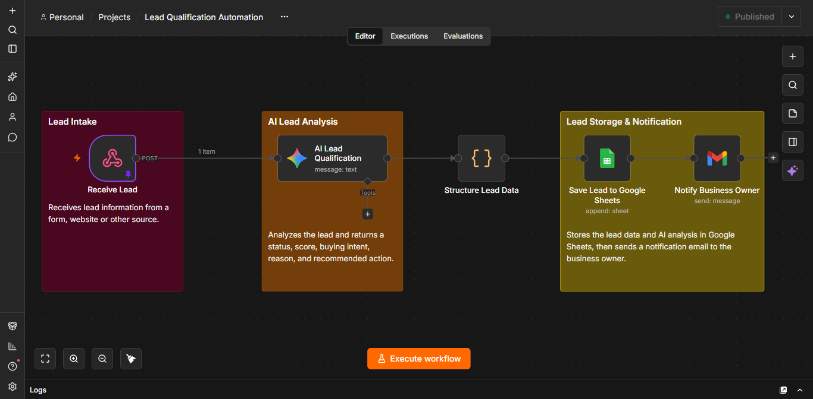
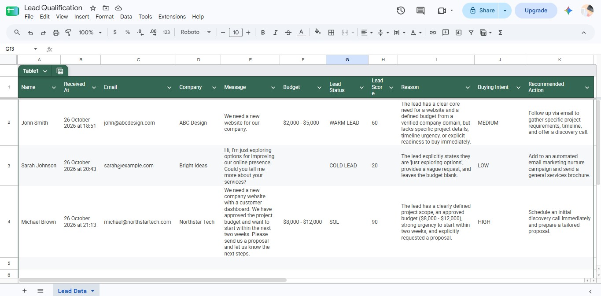
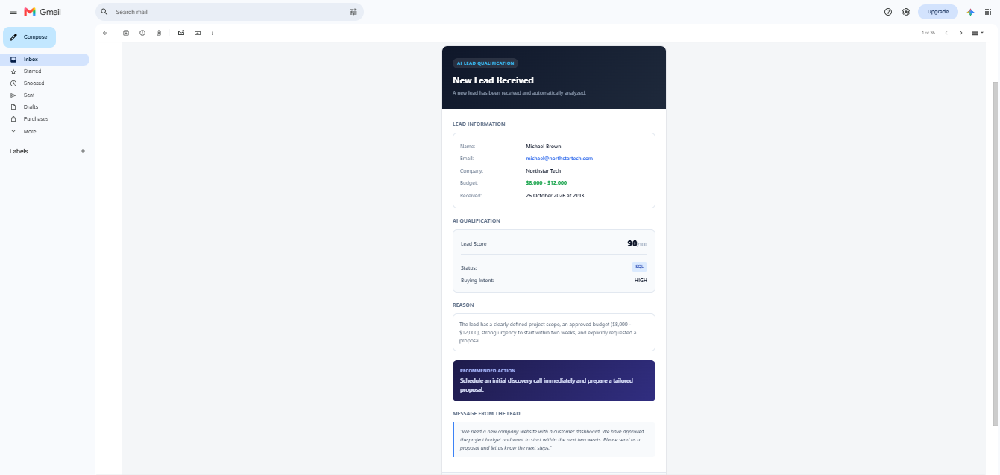

# AI Lead Qualification Automation with n8n

An AI-powered workflow that analyzes incoming business leads, evaluates their buying intent, stores the results in Google Sheets, and automatically sends email notifications to the business owner with the lead details and AI qualification results.

---

## Overview
Manually reviewing business inquiries can take time, especially when it is difficult to identify which leads deserve attention first.

This project uses n8n and Google Gemini to automate the initial lead qualification process. Each lead is analyzed and classified according to its buying intent, helping businesses organize inquiries and prioritize potential opportunities.

---

## Key Features
- **Automated Lead Intake:** Receives lead information through a webhook.
- **AI-Powered Qualification:** Uses Google Gemini to analyze the lead's needs, budget, and buying intent.
- **Lead Scoring:** Assigns a score from 0 to 100.
- **Lead Classification:** Categorizes leads into three levels:
  - 🔵 **COLD LEAD:** Low or unclear buying intent.
  - 🟠 **WARM LEAD:** Genuine interest, but buying readiness is not yet clear.
  - 🟢 **SQL (Sales Qualified Lead):** Strong buying intent and clear indicators of readiness for a sales conversation.
- **Google Sheets Integration:** Stores lead details and AI-generated analysis in a structured spreadsheet.
- **Email Notifications:** Sends a professionally designed HTML email containing lead information and AI qualification results.

---

## Workflow Architecture
The workflow consists of five connected nodes:

| # | Node Name | Description |
|---|---|---|
| **1** | **Receive Lead** | Receives lead information through a webhook. |
| **2** | **AI Lead Qualification** | Uses Google Gemini to classify the lead and generate a status, score, reason, buying intent and recommended action. |
| **3** | **Structure Lead Data** | Organizes the AI response and combines it with the original lead information. |
| **4** | **Save Lead to Google Sheets** | Stores the lead details and qualification results in Google Sheets. |
| **5** | **Notify Business Owner** | Sends a professionally designed HTML email notification with the lead details and AI analysis. |

---

## Screenshots

### 1. Complete Workflow
The complete n8n workflow, showing the automation process from lead reception to email notification.

### 2. Google Sheets — Lead Tracking
Lead information and AI qualification results are organized in Google Sheets, making it easier to review and compare incoming leads.

### 3. Email Notification
A custom-designed HTML email presenting the lead information, qualification status, score, reason, and recommended next action.

---

## Technologies Used
- **n8n** — Workflow automation
- **Google Gemini** — AI-powered lead analysis
- **Google Sheets** — Lead data storage
- **Gmail** — Email notifications
- **JavaScript** — Data processing and transformation
- **Webhooks** — Receiving lead information

---

## Testing
The workflow was tested locally using sample data.

Different test scenarios were used to demonstrate how the AI classifies leads according to their buying intent and generates corresponding qualification results.

The results are stored in Google Sheets, and an email notification is generated for each processed lead.

---

## Project Benefits
- Reduces repetitive manual lead review.
- Helps businesses identify and prioritize potential customers.
- Keeps lead information and qualification results organized in one place.
- Provides a recommended next action for each lead.
- Automates the process from lead reception to email notification.

---

## Project Status
Completed and tested locally with sample data.

> **Note:** This repository showcases the workflow architecture and its results through screenshots.
> Service credentials must be configured when implementing the workflow.
